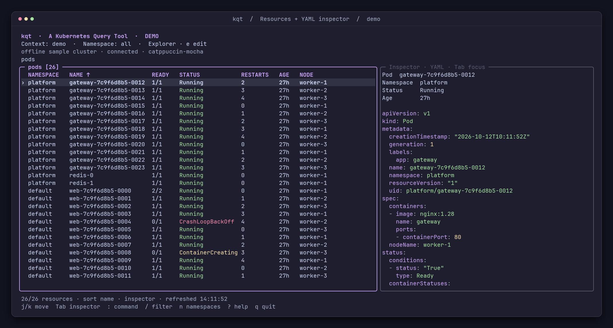
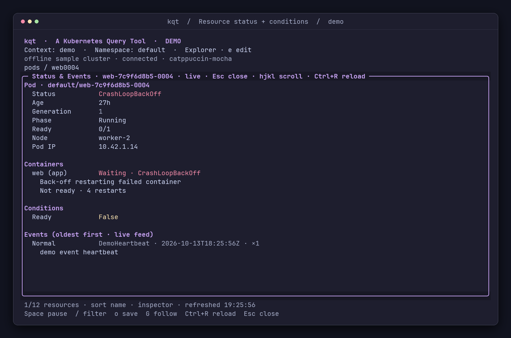
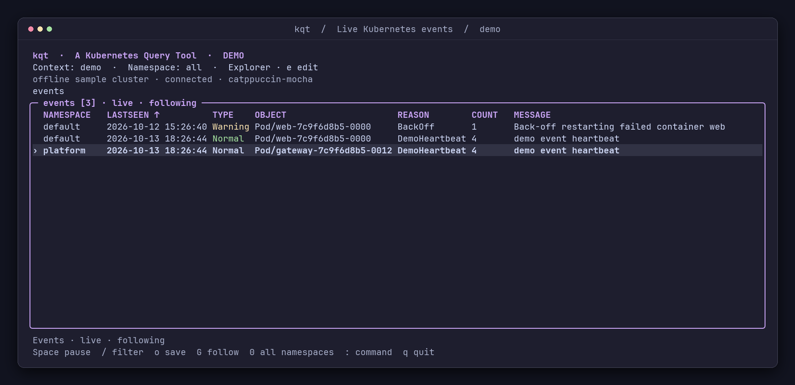

# kqt

**A Kubernetes Query Tool** — a keyboard-first Kubernetes browser with
Maestro's terminal layout, themes, and Go UI libraries.

Inspired by [k9s](https://k9scli.io/), kqt uses Bubble Tea v2, Bubbles v2, Lip Gloss
v2, and the official Kubernetes client-go. It talks directly to Kubernetes;
kubectl is not required at runtime.



## Run

Requires Go 1.27.1 or later; mise pins Go 1.27.1 for this repository.
With mise activated in your shell, the repository's mise configuration adds
`./bin/` to your `PATH` while you work here, so you can run the built binary as
`kqt`.

```sh
go build -trimpath -o bin/kqt ./cmd/kqt
kqt --demo                      # Offline sample cluster
kqt                             # Current context and saved view / namespace
kqt -A                          # Override saved scope: all namespaces
kqt --context staging -n apps --theme nord
kqt --view deploy --layout classic -l app=web
```

With mise and just, use `just build`, `just demo`, and `just check`.

## Binary builds

The **Build binaries** GitHub workflow runs on pushes (including tags), pull
requests, and manual dispatch. Pushing a [SemVer](https://semver.org/) tag such as
`v0.1.0` creates a [GitHub release](https://github.com/z0mbix/kqt/releases) after
the tests and all six builds pass. Tags with prerelease identifiers, such as
`v0.1.0-rc.1`, create prereleases. Invalid version tags fail before building.
Download the matching release archive, or use the workflow run's **Artifacts**
section for development builds:

| Platform | Artifact |
| --- | --- |
| macOS Intel | `kqt-darwin-amd64` |
| macOS Apple Silicon | `kqt-darwin-arm64` |
| Linux x86-64 | `kqt-linux-amd64` |
| Linux ARM64 | `kqt-linux-arm64` |
| FreeBSD x86-64 | `kqt-freebsd-amd64` |
| FreeBSD ARM64 | `kqt-freebsd-arm64` |

Each artifact contains a `.tar.gz` archive and its `.sha256` checksum file. The
archive includes the executable, README, and theme license notices. Extract it
and run the `kqt` executable inside, or copy it onto your PATH. Artifacts are kept
for 30 days; release downloads remain attached to their version. Releases also
include a combined `SHA256SUMS` file. From the download directory, verify the
chosen archive with `shasum -a 256 -c kqt-darwin-arm64.tar.gz.sha256` (adjust the
platform as needed).
Tag builds report the tag as their version; other builds report `dev-<commit>`.
All six targets are cross-compiled on Linux with CGO disabled.

## Kubernetes connection

`--kubeconfig` selects one kubeconfig file. Otherwise Kubernetes's normal
`KUBECONFIG` merging or `~/.kube/config` loading applies. `--context` overrides
current-context for this session; kqt never rewrites kubeconfig. Exec credential
plugins and OIDC are supported by client-go. Without a current context, a context
picker opens. UI preferences never silently select a different Kubernetes context.

## Explore

| Key | Action |
| --- | --- |
| `j/k`, arrows; `g/G`; `Ctrl+U/D` | Move, jump, page |
| `h/l`, arrows | Scroll wide tables or manifests |
| `:`; `Tab` / `Shift+Tab` | Command prompt; cycle completions forward / back |
| `Up` / `Down` in `:` | Recall the last 50 submitted commands |
| `/` | Fuzzy search; `web0003` matches `web-7c9f6d8b5-0003` |
| `n`, `:ns` | Namespace table; Enter selects one |
| `:ns apps`, `:ns -A`, `0` | Set namespace / all namespaces |
| `c`, `:ctx` | Search and switch kubeconfig contexts |
| `r`, `:resources` | Search APIs and discovered custom resources |
| `Enter` | Workload/service/node → pods; otherwise describe |
| `b`, `:related` | Explore owner, backend, pod and storage relationships |
| `C`, `o`, `:copy`, `:export` | Copy or privately save YAML/JSON; optional clean form |
| `a`, `:actions`; `D`, `:delete` | Confirm a workload action or resource deletion |
| `A`, `:permissions`, `:can-i` | Inspect current identity and permissions |
| `U`, `:overview` | Cluster health, capacity, usage and warnings |
| `d`, `y` / `v`, `J` | Describe, highlighted YAML, highlighted JSON |
| `Tab`, then `J` / `y` | Focus inspector, then switch it to JSON / YAML |
| `x` on a Secret | Toggle decoded values in the inspector or details |
| `L`, `P` | Live logs / previous log snapshots from a pod, deployment, or statefulset |
| `Space`, `/`, `f`, `o` in logs | Pause, search, switch live/snapshot, save displayed logs |
| `S` (also `E`), `:status`, `:events selected` | Readable status, conditions, containers, and live events |
| `m`, `:metrics on` / `off` | Toggle pod/node CPU and memory columns |
| `s`, `:shell` | Open a shell in a running pod/container |
| `f`, `:forward LOCAL:REMOTE` | Forward a pod/service port to localhost |
| `x` on a pod/service | Stop forwards associated with the selected resource |
| `F`, `:forwards` | View/manage forwards; `x` stops the selected forward |
| `e`, `:edit` | Open the selected resource in your editor |
| `t`, `:themes` | Fuzzy theme picker with reversible previews |
| `:layouts`, `:layout NAME` | Choose a saved layout |
| `:write NAME` | Save current arrangement, columns, sort, and wide state |
| `i`, `w` | Cycle inspector positions, wide fields |
| `O` | Sort by the next visible column, ascending; wraps to the first |
| `Shift+Left/Right` or `[` / `]` | Sort by the previous / next visible column |
| `R` | Reverse current sort direction |
| `:sort`, `:sort COLUMN asc` / `desc` | Choose a column or set its order explicitly |
| `Ctrl+R`, `Escape`, `?`, `q` | Refresh, back/close, help, quit |

Completion covers commands, resource names and aliases, theme/layout names,
contexts, known namespaces, and inspector/sort options. Tab only fills the
prompt; Enter executes. Printable navigation keys stay text in input fields.
Pickers use arrows or `Ctrl+J/K` while you type to search.

In the command prompt, Up recalls older commands and Down recalls newer ones.
Down past the newest entry restores your unfinished command and cursor position.
Recalling a command only fills the prompt; Enter executes it. The last 50 nonempty
submitted commands are saved as `command_history` in your config file and remain
available after restarting. Cancelled commands and search text are not recorded.

Examples: `:po`, `:deploy`, `:sts`, `:svc`, `:nodes`, `:pvc`, `:events`, `:crd`,
`:widgets.example.com`. Discovery uses preferred API versions, including CRDs.
If discovery is incomplete, a warning appears and built-in views remain usable.

`:labels app=web` applies a Kubernetes label selector at the API; `:labels`
clears it. Workload/service Enter follows real selectors; node Enter uses a node
field selector. Escape restores the parent route and selection.

Resource tables follow Kubernetes list/watch streams by default, including
custom resources. If watching is unavailable, tables visibly fall back to polling
at the configured interval (two seconds by default), with failure backoff. The connection
header stays **connected** during healthy background refreshes; **loading** is
reserved for connection/initial loading. Failed requests retain the last good
snapshot with a **STALE** label. Context and route changes cancel requests, clear
old data, and reject obsolete responses. Selection survives refresh and sort.

Click a column header to sort ascending, and click it again to reverse direction.
The underlined header and `↑` / `↓` mark the active sort. `O` cycles through
visible columns, sorting ascending each time; `R` reverses the current direction.
`Shift+Left/Right` or `[` / `]` cycles backward / forward. Mouse and keyboard sorting
preserve the selected resource, and
the order is saved per resource in the active layout. `:sort` opens a searchable
column picker, including custom columns and enabled metrics. Sorting uses numeric
values and exact timestamps for age/event time. Explicit sorting takes precedence
over fuzzy-match ranking. Choosing an order stops live-event following until `G`
resumes it. Mouse clicks select rows or focus the inspector; the wheel scrolls the
pane under the pointer. Terminal text selection usually requires holding Shift
while using the mouse; the exact modifier depends on your terminal.

YAML and JSON use the active palette's syntax colours in full-screen panels and
inspectors. In the table, `J` opens JSON. With the inspector focused, `J` changes
only the inspector to JSON and `y` changes it back to YAML. In an open manifest
panel, `J` and `y` also switch formats. `:inspector json` / `:inspector yaml` are
available without changing focus. Secret values are hidden by default. Press
`x` on a Secret to reveal decoded values in its inspector/describe/YAML/JSON view;
press `x` again to hide them. Without an inspector, `x` opens the YAML panel.
The view is labelled **values visible · decoded** while revealed. Moving to
another resource, changing scope/context, closing details, or opening the editor
hides values again; reveal state is never saved. Binary values are labelled and
retain base64 text. Custom table columns stay redacted. Highlighting preserves
displayed text, quoting, and spacing.

## Logs

Select a pod, deployment, or statefulset and press `L`. For a workload, kqt reads
all pods matching its selector in its namespace. Multi-container resources offer
a container picker, including an all-containers option. Within logs, `c` selects
a container, `p` toggles previous logs, and `Ctrl+R` reloads.
Logs fill the main pane, keeping the cluster and namespace visible. Container
colour codes and other terminal escape sequences are removed before kqt applies
the selected theme. Highlighting is automatic for each line: complete JSON
objects/arrays get syntax colours, including severity colours for `level`,
`severity`, and `lvl` values. Plain-text logs get subtle timestamp/source colours
and highlighted levels such as `INFO`, `WARN`, and `ERROR`. Mixed formats work
together; incomplete JSON and other text stay readable. Messages keep their
original spacing and order, and saved logs contain plain text without colour codes.

Logs follow live by default. Workloads attach to new matching pods and stop
following removed pods; discovery reconciles every two seconds. Output from
multiple sources identifies each pod/container. A selected individual pod stays
bound to its UID; a replacement requires closing logs and selecting it again.
Streams reconnect using timestamps to avoid replaying already displayed lines.

`Space` pauses the display while collection continues in a bounded buffer. `/`
filters lines by text, ignoring case; `G` returns to following the bottom after
scrolling up. `o` saves the displayed, filtered buffer to a private file, refusing
to overwrite an existing file. Logs wrap by default; `w` toggles wrapping, and
`h/l` scrolls unwrapped lines.

`f` switches between live logs and snapshots. Previous logs (`P` / `p`) are
snapshots. Snapshots read up to 500 lines / 1 MiB per source, at most four sources
concurrently, and 4 MiB combined. Live collection starts with the last 200 lines
per source, retains at most 4 MiB / 10,000 lines, and follows at most 64 containers.
Discarded/truncated output and individual source errors are labelled. Closing
logs, switching contexts, and quitting cancel the streams.

## Events and metrics

`S` (also `E`, or `:status`) shows a readable status summary, pod container states/restarts,
workload replica counts, and conditions with reasons, messages, and transition
times. Colours distinguish readiness from failure/pressure predicates; unknown
custom conditions retain neutral colours. Other custom-resource status fields
appear as highlighted YAML. Resources without status say so explicitly.

Events follow below, matched by immutable UID and updated live. Status refreshes
at the configured interval; events appear oldest first so new activity follows
at the bottom. Scroll with `j/k` or `Ctrl+U/D`; `G` follows the latest event.
`Space` pauses the display while collection continues, `/` filters events, and
`o` saves the displayed status and events to a private file. `Ctrl+R` reloads.
Status remains readable if event permissions/API requests fail, with the failure
shown separately. `R` reverses the table sort.


`:events` opens a live event table for the current namespace; `0` switches to all
namespaces and `n` selects a namespace. The table supports the same pause,
filter, follow, and export controls. `:events selected` opens the resource status
panel. There is no separate watch command.

Repeat counts update one row per event UID. Each view retains up to 2,000 records
or 4 MiB of event data, evicting the oldest observations. Events removed by the
API stay in this history with a `removed` label. Reconnection resumes from the
last received resource version; expired history is reloaded with a visible gap
notice. Events already expired from Kubernetes retention cannot be recovered.
Event access requires `list` and `watch` permissions; resource status also uses
`get`. Exports use mode `0600` and refuse to overwrite an existing file.



`m` adds CPU and memory usage to pod/node tables. The cluster must provide the
[Metrics API](https://kubernetes.io/docs/tasks/debug/debug-cluster/resource-metrics-pipeline/),
normally through Metrics Server. Missing permissions, unavailable APIs, and
pending samples are reported without disrupting resource browsing. Usage sorts
numerically and is kept separate from the original YAML/JSON manifests.

Custom columns also accept `cpu`, `memory`, `cpu%`, and `memory%`. Percentages
compare pod usage against summed application-container limits, or node usage
against allocatable capacity. If any application container lacks the relevant
limit, the pod percentage is unavailable. Missing samples/limits display `—`.

## Shells and port forwarding

`s` opens `/bin/sh` in the selected running pod, offering a picker when several
containers are running. Configure another command with `shell: "/bin/bash"` in
the settings file. Arguments support quoting and run directly inside the chosen
container. Missing shells and Kubernetes permission denials are displayed.

The shell takes over the native terminal, including resize delivery, then returns
to kqt on exit. `Ctrl+C` goes to the remote process; `Ctrl+]` disconnects locally.
kqt verifies the pod UID immediately before opening the connection. Kubernetes's
exec endpoint addresses a pod by name, so that check is not an atomic UID
precondition. Shells use native client-go; kubectl is not required.

`f` prepares a forwarding command from the pod/service's declared TCP port, or
enter `:forward 8080:80` directly. A local port of `0` chooses a free port. Service
ports resolve named target ports against a ready matching pod; the actual pod and
local address are shown when ready. The selected pod stays fixed for that forward.

`F` / `:forwards` lists active and recently completed forwards. Select one to
inspect its destination and status; `x` stops it. `:forward stop ID` and
`:forward stop all` also work. On a selected pod or service in the resource list
or its YAML/JSON details, `x` stops all forwards associated with that resource.
Service forwards can also be stopped from their resolved target pod. Cancellation
shows `stopping` until the listener closes, then `stopped`; it does not change
unrelated forwards. Listeners bind only to `127.0.0.1`. Up to 16 forwards
can run concurrently; namespace changes retain them, context changes and quitting
close them. Forwarding uses native client-go. Shells and forwards try WebSocket
transport with SPDY fallback for compatible upgrade/proxy failures.

## Editing

`e` fetches a fresh, full resource and opens a private temporary YAML file in:

1. The config's `editor` command, if set.
2. `$EDITOR`, then `$VISUAL`, then `vi`.

Commands may contain quoted arguments, for example `code --wait` or `nvim -f`.
They run directly, without a shell. Use an editor's wait/foreground option so it
exits only after you finish editing.

Saving changes and exiting successfully applies a minimal JSON merge patch with
UID and resourceVersion preconditions. Exiting without changes performs no
write. Identity fields cannot change; status and managedFields are omitted and
cannot be edited. Kubernetes enforces schema validation and update permissions.
Conflicts, invalid YAML, or editor failures keep the private file and display its
path for recovery. Successful/unchanged edits remove the temporary file and
refresh the table. In demo mode, edits affect only the sample backend.

Secrets are hidden by default in browsing views, with `x` for temporary decoded
inspection. Editing a Secret fetches its original API data, so decoded values
or redaction placeholders cannot overwrite it. The edit file's directory and
file permissions are private. Pod logs and other resources may contain sensitive
content; ordinary Kubernetes RBAC still applies.

## Saved settings and layouts

Settings live in `$XDG_CONFIG_HOME/kqt/config.yaml`, or
`~/.config/kqt/config.yaml`. Missing files use defaults and are created when
preferences are saved. View and namespace are saved automatically, per context.
Theme selection, inspector format, and chosen layout are also saved. Launch flags
override saved values. A theme preview is not saved until Enter; Escape cancels it.
The theme name appears on the connection line for ten seconds after selection.

To keep settings from an earlier `ket` build, copy its `config.yaml` (or
`config.toml`) and `themes/` directory into `~/.config/kqt/`, respecting
`XDG_CONFIG_HOME` if set. Preserve any existing `kqt` configuration. Update
`KET_THEME` to `KQT_THEME` in your shell configuration.

```sh
kqt config                      # Print a YAML example
kqt config --validate
kqt config --validate --config ./my-config.yaml
```

```yaml
version: 1
theme: catppuccin-mocha
layout: troubleshooting
view: pods
namespace: default
inspector_format: yaml
refresh_interval: 2s
editor: "code --wait"

views:
  pods:
    columns: [namespace, name, ready, status, restarts, age, node]
    sort: name

layouts:
  troubleshooting:
    extends: inspector
    inspector_percent: 40
    wide: false
    views:
      pods:
        columns: [namespace, name, ready, status, restarts, node, age]
        sort: restarts
        descending: true
```

Built-in layouts are `classic` (no inspector), `inspector` (right pane at 120+
columns), and `bottom` (bottom pane at 24+ rows). Named layouts can inherit one
another, choose `none` / `right` / `bottom`, and override the inspector percentage,
columns, sorting, and wide mode. `:layouts` searches all built-in and saved names.
`:write NAME` saves the current configuration into the same YAML file; aliases
`:layout save NAME` and `:layouts NAME` also work. Smaller terminals collapse a
right inspector; full-screen details stay available.

`:columns name,status,age` saves columns for the active layout. `:sort age` and
`O` / `R` change sorting; `:write NAME` includes that sort in the saved profile.
JSON Pointer columns such as `/spec/replicas` and
`/metadata/labels/app.kubernetes.io~1name` are supported. Numeric fields sort
numerically; age uses creation time.

All 18 Maestro palettes are bundled. `kqt themes` lists them. `--theme`
overrides `KQT_THEME`, which overrides the saved theme. Custom themes retain the
Maestro TOML format under `themes/NAME.toml` beside the settings file:

```toml
version = 1
name = "company"
extends = "nord"
[colors]
accent = "#8be9fd"
```

[Palette attribution and upstream notices](internal/tui/THEMES.md) are retained.
Config errors and inheritance cycles fail visibly. Preference writes preserve
unrelated YAML settings and comments and replace the file atomically. An invalid
file is not overwritten. Restart to load manual configuration changes.

Existing default `config.toml` settings are loaded if no YAML file exists, then
carried into `config.yaml` on the first save; the old file stays unchanged.
Explicit TOML config paths are still supported. No connection credentials are
stored in kqt's UI config.

## Verification and remaining scope

```sh
go test -race ./...
go vet ./...
python3 scripts/tui-smoke.py --binary bin/kqt
```

`just check`, `just smoke`, and `just smoke-live` are provided. The live check uses
Docker, k3d, and kubectl to create a disposable cluster, apply controlled
fixtures, exercise the TUI, and clean up, with a separate temporary kubeconfig.
Optional `--snapshots artifacts/demo` records screen text and ANSI.

Tests cover API contracts, selectors, pagination, discovery, cancellation,
versioned editing, secret redaction, saved settings and migration, layout
inheritance, completion, fuzzy matching, syntax highlighting, theme timing,
inspector focus, terminal dimensions, and log aggregation. PTY checks cover
editor terminal handoff/restoration and saved-state restart as well.

Resource relationships, workload actions and live resource tables are available.
See the sections below for their controls and behavior.
See [the design](docs/design.md), [verification](docs/verification.md), and
[the pod-shell assessment](docs/pod-shell-assessment.md).

## Related resources

Press `b` or run `:related` (`:relations`) for a searchable list of related
resources. Enter follows a link; Escape returns to the previous resource view.
Owner chains follow immutable owner UIDs. Workloads/services/nodes expose matching
pods; Deployments expose owned ReplicaSets and CronJobs expose owned Jobs.
Ingresses link to backend Services, pods link to their node and mounted PVCs,
and PVCs/PVs link to their bound storage counterpart. Permission failures or
missing/replaced references leave available links usable and show a warning.

## Copying and exporting manifests

`C` copies the selected manifest using the terminal's OSC52 clipboard support;
`o` prompts for a private file destination. Both work in YAML/JSON details.
`:copy yaml`, `:copy json clean`, and `:export json clean "saved manifest.json"`
choose the format explicitly. The `clean` option removes generated metadata,
owner references and status while preserving resource specifications. Exported
files use mode `0600` and never replace an existing file. Clipboard support varies
by terminal; the notice confirms that the request was sent, and file export is
available independently. Clipboard requests are limited to 1 MiB.

Secret exports are redacted while values are hidden. After `x` reveals a Secret,
copy/export uses its original Kubernetes base64 data, rather than the decoded
inspection form. Hiding values restores redacted exports.

## Workload actions

`a` / `:actions` lists actions for the selected resource. Deployments,
StatefulSets and ReplicaSets support `:scale N`; Deployments, StatefulSets and
DaemonSets support `:restart`. CronJobs support `:suspend`, `:resume`, and `:run`
(create one Job immediately from the job template). `D` / `:delete` requests
normal Kubernetes deletion of the selected resource.

Every action shows the context, resource and intended change, then requires its
exact `namespace/name` (or name for a cluster-scoped resource) to confirm.
Escape cancels. The resource UID and desired specification are checked before applying; patches
and deletions carry identity/version preconditions. Background status updates
are accepted, while changed specifications require a fresh selection. Permissions are enforced by Kubernetes. A successful request
is reported separately from controller reconciliation; `S` shows rollout status
and events. Cancelling a request already in progress does not roll back changes;
refresh to check its final state.

## Live resource tables

Ordinary resource tables now use Kubernetes list/watch streams. Added, modified
and deleted objects update the table and inspector while preserving selection.
Expired watch history triggers a full resync; partial lists never replace the
last complete snapshot, and resources absent from the new list are removed.
Reconnection retains visible data and labels stale states. `Ctrl+R` / `:refresh`
restarts the list/watch. Context and scope changes, editor/shell handoff and quit
cancel the watch. Metrics continue refreshing independently at the configured
interval. Watch permission/API failures leave browsing available through a
labelled polling fallback. Revealed Secret values are hidden when that Secret
changes; press `x` to fetch and reveal its current values again.

## Permissions and read-only mode

`A` / `:permissions` (`:access`) shows your API-reported identity and current
resource permissions, including pod logs, shell and forwarding subresources.
`:can-i get`, `:can-i patch`, or `:can-i get log` checks one action. Results are
labelled Allowed, Denied or Unknown; a failed/unavailable review is never treated
as a denial. Kubernetes admission policies can impose further rules. `Ctrl+R`
rechecks and Escape closes the panel.

Start with `kqt --read-only` or configure `read_only: true` to disable editing,
workload operations and pod shells. The header displays **READ ONLY**. Inspection,
logs/events, permission reviews, clipboard/file exports and port forwarding remain
available. `--read-only=false` explicitly overrides a configured read-only default
for that session. This mode restricts kqt's controls; it does not alter your
Kubernetes credentials or replace cluster authorization.

## Cluster overview

`U` / `:overview` opens cluster health, workload counts, node pressure and
allocatable capacity, observed CPU/memory usage, unhealthy resources and the ten
most recent warning events. Workload/event scope follows the current namespace;
node capacity and usage are labelled as cluster-wide. Missing permissions or
metrics are shown as unavailable, with sample coverage reported for usage totals.

The summary refreshes automatically every five seconds or the configured interval
if longer. `Ctrl+R` reloads, `0` switches to all namespaces, `n` opens namespace
selection, and Enter opens a searchable list of unhealthy resources to explore.
Use arrows or the mouse wheel to scroll; Escape returns to the resource table.
